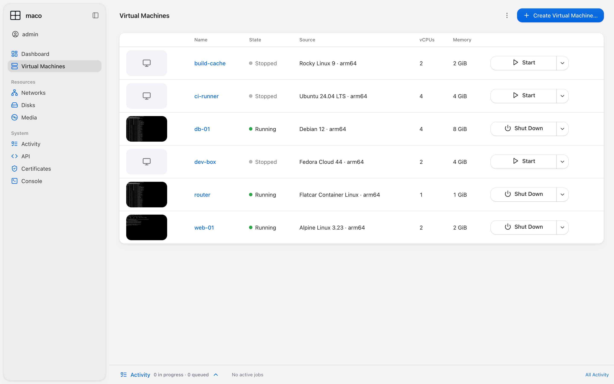
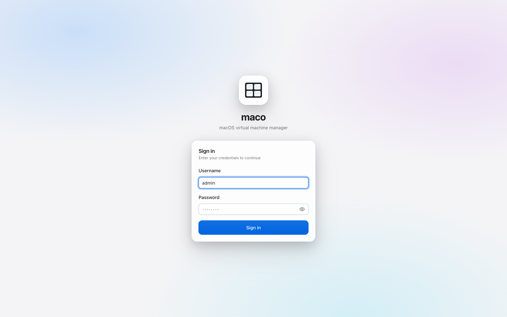
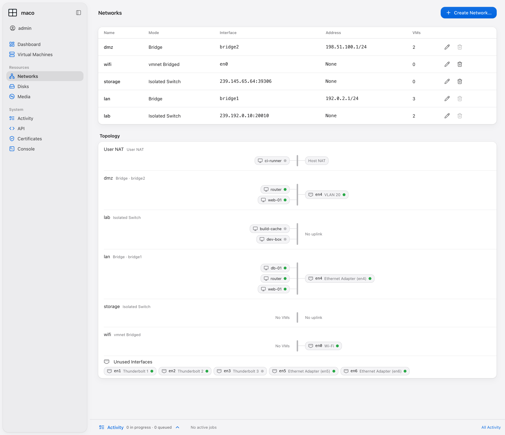
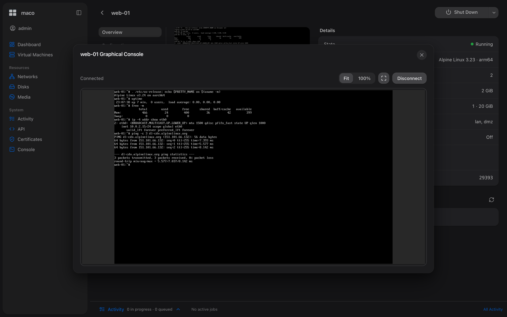
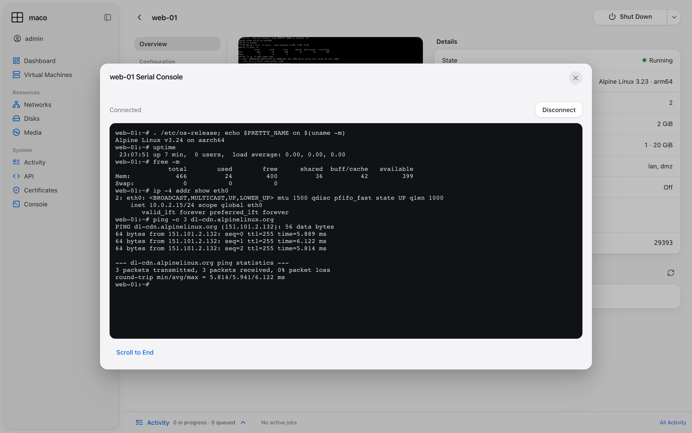
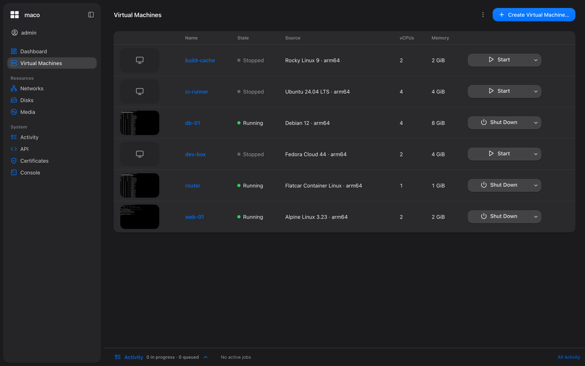
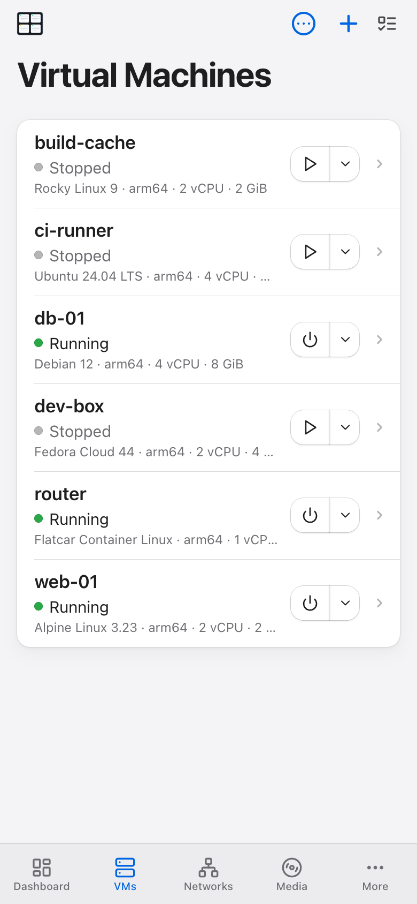

# maco

A virtual machine manager for macOS on Apple Silicon, with a web UI, a CLI and
an HTTP API. One binary: the UI and a patched QEMU are built in.

Website and releases: https://maco.chevalrouting.org

## Install a release

```bash
curl -LO https://maco.chevalrouting.org/downloads/maco-0.1.0-darwin-arm64.tar.gz
tar -xzf maco-0.1.0-darwin-arm64.tar.gz
sudo ./maco install
sudo maco user passwd admin --password 'choose-a-password'
```

The site also has an installer package and the checksums.

## Build and install

```bash
brew install go-task pkg-config libusb
git clone https://github.com/ChevalRouting/maco && cd maco
task build-ui
sudo ./maco install
sudo maco user passwd admin --password 'choose-a-password'
```

Open https://localhost:8080 and sign in as `admin`. To build an installer
package instead, run `task pkg VERSION=0.1.0`. More in
[docs/install.md](docs/install.md).

## Run a VM from the CLI

```bash
cat > user-data.yaml <<EOF
#cloud-config
users:
  - name: admin
    sudo: ALL=(ALL) NOPASSWD:ALL
    ssh_authorized_keys:
      - $(cat ~/.ssh/id_ed25519.pub)
EOF

sudo maco image pull debian-12-arm64
sudo maco vm new web1 --image debian-12-arm64 --guest-config user-data.yaml
sudo maco vm start web1
sudo maco vm list
sudo maco vm console web1          # Ctrl+A Q to detach
sudo maco vm stop web1
```

Put VMs on a bridge to your LAN, optionally on a VLAN:

```bash
sudo maco networks create lan --member en0
sudo maco networks create dmz --vlan en0:20
sudo maco vm new db1 --network lan
```

The [CLI reference](docs/cli.md) and the rest of the [docs](docs/README.md)
cover everything else.

## Screenshots



| Sign in | Networks and topology |
|---|---|
|  |  |
| **Graphical console** | **Serial console** |
|  |  |
| **Dark mode** | **iPhone** |
|  |  |

## AI Slop

As AI usage keeps increasing everywhere, this project is probably the most AI-clanked one I've worked on, but that was actually the goal. I wanted to see if I could work on something "big" that could genuinely make my life easier.

To be totally transparent, I think I worked for around 10 hours straight on this project. About 10% of that time was spent debugging and trying to understand why the AI was doing some weird shit, and the other 90% was testing and basically doing QA on the code it wrote.

That's quite impressive, but I truly believe AI is still just a tool that writes the code while following the owner's vision of the project. I'm very careful about how the UI should look and which features I need or want, without giving too much freedom to the AI. On this project, though, my role definitely changed. Instead of writing most of the code myself, I was more like a manager, keeping the whole project in mind, making the decisions, and making sure the implementation actually matched what I wanted.

Is that bad? Well, I don't know yet.

I don't think I could have written this project from scratch in such a short amount of time, and the code could 100% have been worse than what I ended up with.

The project itself isn't actually that complicated. It's basically calling external tools like QEMU, communicating over sockets, handling HTTP/WebSocket APIs, and requiring some networking knowledge, specifically understanding how macOS networking works and what you can do with it (the veth pair + BPF helper, for example).

So yes, you can consider this project AI slop. But it's also what actually powers my Mac mini server running VMs in my homelab. It's useful, it works, and considering it took around 10 hours to build, I think that's mooooore than a success, IMO.

## License

maco is released under the [MIT License](LICENSE). Production builds bundle QEMU (GPLv2) and link libusb (LGPL-2.1); see [docs/building.md](docs/building.md#patched-qemu).
